  
  

Coordeno o time de tecnologia da **LUZA Group** (14 pessoas) e venho de desenvolvimento full stack em C#/.NET, Scrum Master e Squad Leader na **DTI Digital**, em sistemas corporativos e integrações com SAP S/4HANA e Salesforce. Gosto de dar ao time referências claras de trabalho: revisão de código, documentação e um fluxo que todo mundo entende.

**Resultados recentes**

- Lead Time de um squad de integrações caiu 58% (de 36,18 para 15,18 dias úteis).
- Bugs de produção passaram de 14,4% para 0,9% do trabalho concluído numa frente de sustentação.
- Migração de 31 sistemas para InterSystems IRIS, com até três squads em paralelo.
- Consulta de backend de 22,1 s para 907 ms, trocando hidratação de entidades por projeção em DTO.

  

### Projetos

Ferramentas para quem trabalha com agentes de IA, todas com licença MIT, releases versionadas e documentação em português e inglês.

  
  
  
  

### Stack

  
  
  

<b>Stack completa</b>

 

<table>
  <tr><td><b>Back-end</b></td><td>C# · .NET · Node.js · SQL Server · PHP</td></tr>
  <tr><td><b>Front-end e automação</b></td><td>TypeScript · Angular · PrimeNG · PowerShell</td></tr>
  <tr><td><b>Nuvem e integrações</b></td><td>Azure Functions · Event Grid · Storage · APIs e microsserviços · SAP S/4HANA · Salesforce · IdentityServer · Keycloak · InterSystems IRIS</td></tr>
  <tr><td><b>IA no desenvolvimento</b></td><td>Claude Code · Codex · Cursor · Antigravity</td></tr>
  <tr><td><b>Entrega</b></td><td>Azure DevOps · Jira · CI/CD · revisão de código · Scrum e Kanban</td></tr>
</table>

<b>Read in English</b>

 

I'm Saulo, Technology and Development Coordinator at **LUZA Group** in Belo Horizonte, Brazil, leading a team of 14. Before that, at **DTI Digital**, I was a full-stack C#/.NET developer, Scrum Master and Squad Leader on corporate systems and SAP S/4HANA and Salesforce integrations. I like giving teams clear working references: code review, documentation and a flow everyone understands.

**Recent results**

- Cut an integrations squad's story lead time by 58% (36.18 to 15.18 working days).
- Brought production bugs from 14.4% to 0.9% of completed work on a maintenance stream.
- Coordinated the migration of 31 systems to InterSystems IRIS, with up to three squads in parallel.
- Took a backend query from 22.1 s to 907 ms by replacing entity hydration with a DTO projection.

**Projects**

- **[CareerBounty](https://github.com/soulrocha/career-bounty)**: a job-search agent for Claude Code. A deterministic Node CLI with zero npm dependencies, subagents for the language work and a local panel. It only uses facts backed by evidence, and a hook blocks anything you did not approve.
- **[snapmd](https://github.com/soulrocha/snapmd)**: a Chrome and Edge extension that turns the live page (form state, grids, terminals, open modals) into LLM-ready Markdown, 100% local.
- **[Claude Code Hero Journey](https://github.com/soulrocha/Claude-code-hero-journey)**: a HUD mod for Claude Code, in the desktop app and the terminal, that shows what the agent is doing and guards sensitive files.
- **[Coucou](https://github.com/Louis-CFM/coucou)** (open source contribution): [PR #879](https://github.com/Louis-CFM/coucou/pull/879), under review, brings island placement on any display to Windows.

**Stack**

- **Back end:** C#, .NET, Node.js, SQL Server, PHP
- **Front end and automation:** TypeScript, Angular, PrimeNG, PowerShell
- **Cloud and integrations:** Azure Functions, Event Grid, Storage, APIs and microservices, SAP S/4HANA, Salesforce, IdentityServer, Keycloak, InterSystems IRIS
- **AI in development:** Claude Code, Codex, Cursor, Antigravity
- **Delivery:** Azure DevOps, Jira, CI/CD, code review, Scrum and Kanban

