  
  

  

  Gosto de dar ao time referências claras de trabalho: revisão de código, documentação e um fluxo que todo mundo entende. 
  Também construo ferramentas para quem trabalha com agentes de IA, e algumas estão aqui.

  
  
  
  

  

  
  
  

<b>Grimório completo</b>

 

<table>
  <tr><td><b>Agentes de IA</b></td><td>Claude Code · Codex · Cursor · Antigravity</td></tr>
  <tr><td><b>Construo com IA</b></td><td>TypeScript · Angular · PrimeNG · PowerShell</td></tr>
  <tr><td><b>Nuvem e integrações</b></td><td>Azure Functions · Event Grid · Storage · APIs e microsserviços · SAP S/4HANA · Salesforce · IdentityServer · Keycloak · InterSystems IRIS</td></tr>
  <tr><td><b>Entrega</b></td><td>Azure DevOps · Jira · Teams · CI/CD · revisão de código · Scrum e Kanban</td></tr>
</table>

<b>Read in English</b>

 

Hi! I'm Saulo, Technology and Development Coordinator at **LUZA Group**, in Belo Horizonte, Brazil. Before that, at **DTI Digital**, I was a full-stack developer (clients Pottencial and Ânima), Scrum Master (Hermes Pardini / Grupo Fleury) and Squad Leader of two squads at **MRV&CO**, working on corporate systems and integrations.

I like giving teams clear working references: code review, documentation and a flow everyone understands. I also build tools for people who work with AI agents, and some of them live here.

**Active quests**

- **[Claude Code Hero Journey](https://github.com/soulrocha/Claude-code-hero-journey)**: a cozy RPG HUD for Claude Code. The Clawds show what the agent is doing, a dragon guards sensitive files and a grimoire keeps what you learned. `beta · desktop app`
- **[snapmd](https://github.com/soulrocha/snapmd)**: high-fidelity Markdown from SPAs, enterprise portals, open modals and dynamic web apps.
- **[CareerBounty](https://github.com/soulrocha/career-bounty)**: a full agent inside Claude Code. A deterministic Node CLI, skills and subagents for the language work, and a local panel. The model only uses facts backed by evidence, and a hook blocks anything you did not approve. `Node · zero npm dependencies · CI`

**Contributions**

- **[Coucou](https://github.com/Louis-CFM/coucou)** (AI agent monitor): [PR #879](https://github.com/Louis-CFM/coucou/pull/879) brings island placement, on any display, to Windows.

**Grimoire**

- **Code:** C#, .NET, Node.js, JavaScript, SQL Server, PHP, WordPress, Azure
- **AI agents:** Claude Code, Codex, Cursor, Antigravity
- **Built with AI:** TypeScript, Angular, PrimeNG, PowerShell
- **Cloud and integrations:** Azure Functions, Event Grid, Storage, APIs and microservices, SAP S/4HANA, Salesforce, IdentityServer, Keycloak, InterSystems IRIS
- **Delivery:** Azure DevOps, Jira, Teams, CI/CD, code review, Scrum and Kanban

<a href="https://www.linkedin.com/in/soulrocha"><b>Let's talk on LinkedIn →</b></a>

