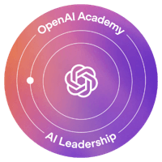
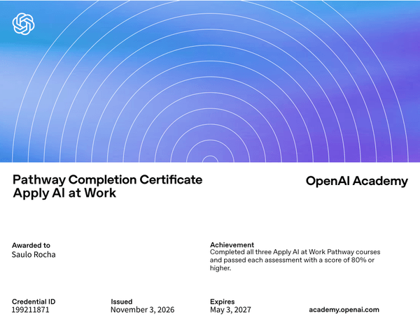
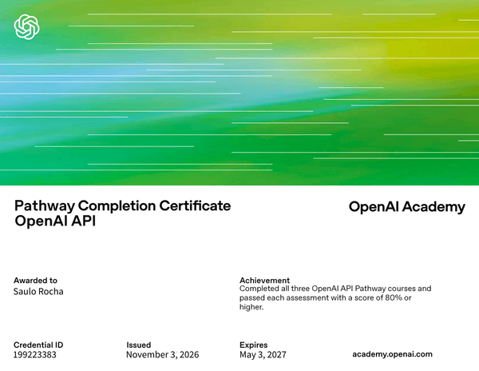
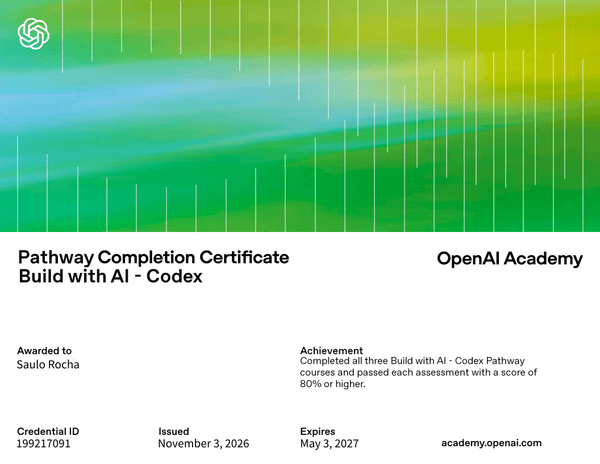

  
  

Coordeno o time de tecnologia da **LUZA Group** (14 pessoas) e venho de desenvolvimento full stack em C#/.NET, Scrum Master e Squad Leader na **DTI Digital**, em sistemas corporativos e integrações com SAP S/4HANA e Salesforce. Gosto de dar ao time referências claras de trabalho: revisão de código, documentação e um fluxo que todo mundo entende.

**Resultados recentes**

- Lead Time de um squad de integrações caiu 58% (de 36,18 para 15,18 dias úteis).
- Bugs de produção passaram de 14,4% para 0,9% do trabalho concluído numa frente de sustentação.
- Migração de 31 sistemas para InterSystems IRIS, com até três squads em paralelo.
- Consulta de backend de 22,1 s para 907 ms, trocando hidratação de entidades por projeção em DTO.

  

### Projetos

Ferramentas para quem trabalha com agentes de IA, todas com licença MIT, releases versionadas e documentação em português e inglês.

  
  
  

### Contribuições open source

  
  

<b>O que fiz no Polestar</b>

 

[Polestar](https://github.com/fitzforge/polestar) é um addon de guias de leveling para World of Warcraft. Levei a interface e os guias para o português do Brasil e mexi na janela de guias e nos testes.

**Tradução para português do Brasil**

- [#904](https://github.com/fitzforge/polestar/pull/904): os 246 textos da interface ainda em inglês (Polestar e o Recorder).
- [#1054](https://github.com/fitzforge/polestar/pull/1054) e [#1055](https://github.com/fitzforge/polestar/pull/1055): guias de leveling da Horda e da Aliança.
- [#1056](https://github.com/fitzforge/polestar/pull/1056), [#1057](https://github.com/fitzforge/polestar/pull/1057) e [#1058](https://github.com/fitzforge/polestar/pull/1058): guias das nove classes.
- [#1059](https://github.com/fitzforge/polestar/pull/1059) e [#1060](https://github.com/fitzforge/polestar/pull/1060): guias de reputação das capitais, dos campos de batalha e das facções do mundo.
- [#1061](https://github.com/fitzforge/polestar/pull/1061), [#1062](https://github.com/fitzforge/polestar/pull/1062) e [#1063](https://github.com/fitzforge/polestar/pull/1063): guias de profissões, montarias e mascotes, exploração e os títulos do pacote.
- [#1064](https://github.com/fitzforge/polestar/pull/1064): todo texto de interface que restava em inglês (painel de grupo, masmorra, ritmo de nível, Dynamic Questing, cadeias de missões).
- [#1362](https://github.com/fitzforge/polestar/pull/1362): textos novos do hotfix 0.3.6 (o "skyboat" virou "barco celeste").
- [#1454](https://github.com/fitzforge/polestar/pull/1454): 70 textos de interface da 0.3.6 e 499 textos de guia das correções de rota.
- [#1910](https://github.com/fitzforge/polestar/pull/1910): 78 textos de guia que a 0.3.7 deixou vazios, publicados na 0.3.7.1.

**Janela de guias e testes**

- [#1030](https://github.com/fitzforge/polestar/pull/1030): a barra de rolagem dos objetivos parou de dar erro ao passar o mouse.
- [#1146](https://github.com/fitzforge/polestar/pull/1146): a barra de passos continua visível no estilo Transparente, com faixa escura opcional e texto na cor da classe.
- [#1227](https://github.com/fitzforge/polestar/pull/1227): cada medição de memória do pacote ganhou pasta própria, e os testes em paralelo pararam de apagar os arquivos uns dos outros.
- [#1066](https://github.com/fitzforge/polestar/pull/1066) (em revisão): espaço para o card da missão de classe e rolagem dos objetivos por linha inteira.
- [#1067](https://github.com/fitzforge/polestar/pull/1067) (em revisão): modo de altura da janela (Fixa, Segue o passo, Automática).
- [Issue #1315](https://github.com/fitzforge/polestar/issues/1315): propus manter a tradução antiga como sugestão quando um texto muda; o mantenedor implementou.

### Stack

  
  
  

<b>Stack completa</b>

 

<table>
  <tr><td><b>Back-end</b></td><td>C# · .NET · Node.js · SQL Server · PHP</td></tr>
  <tr><td><b>Front-end e automação</b></td><td>TypeScript · Angular · PrimeNG · PowerShell</td></tr>
  <tr><td><b>Nuvem e integrações</b></td><td>Azure Functions · Event Grid · Storage · APIs e microsserviços · SAP S/4HANA · Salesforce · IdentityServer · Keycloak · InterSystems IRIS</td></tr>
  <tr><td><b>IA no desenvolvimento</b></td><td>Claude Code · Codex · Cursor · Antigravity</td></tr>
  <tr><td><b>Entrega</b></td><td>Azure DevOps · Jira · CI/CD · revisão de código · Scrum e Kanban</td></tr>
</table>

### Certificações

<b>Read in English</b>

 

I'm Saulo, Technology and Development Coordinator at **LUZA Group** in Belo Horizonte, Brazil, leading a team of 14. Before that, at **DTI Digital**, I was a full-stack C#/.NET developer, Scrum Master and Squad Leader on corporate systems and SAP S/4HANA and Salesforce integrations. I like giving teams clear working references: code review, documentation and a flow everyone understands.

**Recent results**

- Cut an integrations squad's story lead time by 58% (36.18 to 15.18 working days).
- Brought production bugs from 14.4% to 0.9% of completed work on a maintenance stream.
- Coordinated the migration of 31 systems to InterSystems IRIS, with up to three squads in parallel.
- Took a backend query from 22.1 s to 907 ms by replacing entity hydration with a DTO projection.

**Projects**

- **[CareerBounty](https://github.com/soulrocha/career-bounty)**: a job-search agent for Claude Code. A deterministic Node CLI with zero npm dependencies, subagents for the language work and a local panel. It only uses facts backed by evidence, and a hook blocks anything you did not approve.
- **[snapmd](https://github.com/soulrocha/snapmd)**: a Chrome and Edge extension that turns the live page (form state, grids, terminals, open modals) into LLM-ready Markdown, 100% local.
- **[Claude Code Hero Journey](https://github.com/soulrocha/Claude-code-hero-journey)**: a HUD mod for Claude Code, in the desktop app and the terminal, that shows what the agent is doing and guards sensitive files.

**Open source contributions**

- **[Polestar](https://github.com/fitzforge/polestar)**, a World of Warcraft leveling guide addon: [18 accepted PRs](https://github.com/fitzforge/polestar/pulls?q=is%3Apr+author%3Asoulrocha). I translated the interface and every guide (leveling, all classes, reputations, professions, mounts and pets) into Brazilian Portuguese, fixed the guide window's scroll bar and step bar, and gave the pack's memory tests their own scratch folders so parallel runs stop clashing. Two guide window PRs are under review.
- **[Coucou](https://github.com/Louis-CFM/coucou)**: [PR #879](https://github.com/Louis-CFM/coucou/pull/879), under review, brings island placement on any display to Windows.

**Stack**

- **Back end:** C#, .NET, Node.js, SQL Server, PHP
- **Front end and automation:** TypeScript, Angular, PrimeNG, PowerShell
- **Cloud and integrations:** Azure Functions, Event Grid, Storage, APIs and microservices, SAP S/4HANA, Salesforce, IdentityServer, Keycloak, InterSystems IRIS
- **AI in development:** Claude Code, Codex, Cursor, Antigravity
- **Delivery:** Azure DevOps, Jira, CI/CD, code review, Scrum and Kanban

**Certifications**

- [Professional Scrum Master I (PSM I)](https://www.credly.com/badges/28313c1f-97bb-4b71-80f5-30f69e56a8fe), Scrum.org, November 2026
- OpenAI Academy pathway completion certificates, November 2026: [Apply AI at Work](https://www.credential.net/199211871), [OpenAI API](https://www.credential.net/199223383) and [Build with AI - Codex](https://www.credential.net/199217091)
- [AI Leadership](https://oaiacademy.credential.net/fb2ec792-979e-408f-b3f4-c50aca5a00da), OpenAI Academy, November 2026

