  
   
  A guilda: Antigravity, Cursor, Codex e o Claude (o Invocador, que orquestra os subagentes, e o Engenheiro). No quadro, Azure DevOps e Jira; no céu, o correio do Teams.

Oi! Sou o Saulo. Coordeno o time de Tecnologia e Desenvolvimento na **LUZA Group**. Antes, na **DTI Digital**, passei por dev full stack, Scrum Master e Squad Leader de times de sistemas corporativos e integrações.

Gosto de dar ao time referências claras de trabalho: revisão de código, documentação e um fluxo que todo mundo entende. Também construo ferramentas para quem trabalha com agentes de IA, e algumas estão aqui.

### Quests ativas

  
  <a href="https://github.com/soulrocha/Claude-code-hero-journey"><b>Claude Code Hero Journey</b></a> 
  Uma HUD de RPG para o Claude Code: os Clawds mostram o que o agente está fazendo, um dragão barra os arquivos sensíveis e um grimório guarda o que você aprendeu. 
  <code>beta · app desktop · pt-BR e inglês</code>

 

  
  <a href="https://github.com/soulrocha/snapmd"><b>snapmd</b></a> 
  Extrai Markdown fiel de SPAs, portais corporativos, modais abertos e apps web dinâmicos. 
  <code>JavaScript</code>

 

### Grimório

  
  
  

<table>
  <tr><td><b>Agentes de IA</b></td><td>Claude Code · Codex · Cursor · Antigravity</td></tr>
  <tr><td><b>Construo com IA</b></td><td>TypeScript · Angular · PrimeNG · PowerShell</td></tr>
  <tr><td><b>Nuvem e integrações</b></td><td>Azure Functions · Event Grid · Storage · APIs e microsserviços · SAP S/4HANA · Salesforce · IdentityServer · Keycloak · InterSystems IRIS</td></tr>
  <tr><td><b>Entrega</b></td><td>Azure DevOps · Jira · Teams · CI/CD · revisão de código · Scrum e Kanban</td></tr>
</table>

  

<b>Read in English</b>

 

Hi! I'm Saulo, Technology and Development Coordinator at **LUZA Group**, in Belo Horizonte, Brazil. Before that, at **DTI Digital**, I worked as a full-stack developer, Scrum Master and Squad Leader on teams building corporate systems and integrations.

I like giving teams clear working references: code review, documentation and a flow everyone understands. I also build tools for people who work with AI agents, and some of them live here.

**Active quests**

- **[Claude Code Hero Journey](https://github.com/soulrocha/Claude-code-hero-journey)**: a cozy RPG HUD for Claude Code. The Clawds show what the agent is doing, a dragon guards sensitive files and a grimoire keeps what you learned. `beta · desktop app`
- **[snapmd](https://github.com/soulrocha/snapmd)**: high-fidelity Markdown from SPAs, enterprise portals, open modals and dynamic web apps.

**Grimoire**

- **Code:** C#, .NET, Node.js, JavaScript, SQL Server, PHP, WordPress, Azure
- **AI agents:** Claude Code, Codex, Cursor, Antigravity
- **Built with AI:** TypeScript, Angular, PrimeNG, PowerShell
- **Cloud and integrations:** Azure Functions, Event Grid, Storage, APIs and microservices, SAP S/4HANA, Salesforce, IdentityServer, Keycloak, InterSystems IRIS
- **Delivery:** Azure DevOps, Jira, Teams, CI/CD, code review, Scrum and Kanban

